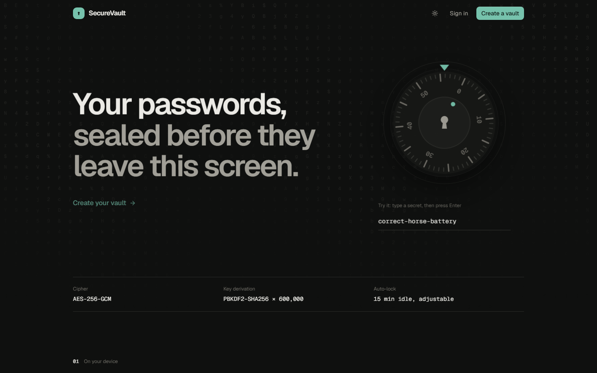

# SecureVault

A zero-knowledge password manager. The browser derives keys from your master
password and encrypts every entry before it leaves the device; the server only
ever stores ciphertext.

**Live:** https://keep-your-passwords-safe.vercel.app



## Features

- **Vault:** passwords with usernames, URLs, notes, custom fields, tags,
  categories and favourites; trash with restore.
- **Generator:** random passwords and passphrases (EFF large wordlist), with a
  strength meter.
- **Security report:** weak, reused and breached passwords. Breach checks use
  the Have I Been Pwned range API, so only the first five characters of a
  hash are sent.
- **Analytics:** charts and stats about the vault.
- **Import and export:** import from Bitwarden, 1Password, Chrome or Edge CSV
  exports; export an encrypted backup.
- **Account security:** email confirmation on sign-up, optional TOTP two-factor
  with backup codes, Google sign-in, auto-lock after idle time and clipboard
  clearing.

## Security model

- Keys are derived in the browser with PBKDF2-SHA256 (600,000 iterations).
  Entries are encrypted with AES-256-GCM under a random vault key, which is
  itself wrapped by a key only the master password can produce.
- The master password never leaves the browser. The server stores a bcrypt
  hash of a derived auth hash, the wrapped vault key and ciphertext.
- The unlocked vault key is a non-extractable `CryptoKey` held in memory only.
  A reload locks the vault.
- Sessions are opaque, revocable tokens in an `HttpOnly; Secure;
  SameSite=Strict` cookie. Writes require a custom header and are rejected
  cross-site. Rate limits are keyed by account and by IP.
- A strict Content Security Policy allows scripts from the site itself only.

## Stack

React 19, TypeScript (strict), Vite, TanStack Router and Query, Zod, Tailwind
CSS v4 and Radix UI. The API is a Hono app running as a Vercel Node function,
with MongoDB through Mongoose. Bun and Turborepo monorepo.

```
apps/web                         the app, the Vercel function (api/) and vercel.json
packages/secure-api              the backend: Hono routes, Mongoose models, security
packages/secure-service          every browser-to-API call
packages/crypto-service          browser crypto: key derivation, encryption, generators
packages/business-logic-secure   hooks, the in-memory vault session, derivations
packages/formatting-service      date formatters
packages/*-config                shared TypeScript and ESLint config
```

See [MONOREPO.md](MONOREPO.md) for the layout and dependency direction.

## Running locally

Requires [Bun](https://bun.sh), Node 22 or later and a MongoDB database.

```bash
bun install
cp apps/web/.env.example apps/web/.env.local   # then fill it in
bun run dev                                    # http://localhost:5173, API under /api
```

Environment variables (see `apps/web/.env.example`):

| Name | Required | Purpose |
| --- | --- | --- |
| `MONGODB_URI` | yes | MongoDB connection string |
| `SERVER_SECRET` | yes | At least 32 random characters, signs server-side tokens |
| `GOOGLE_CLIENT_ID`, `GOOGLE_CLIENT_SECRET` | no | Google sign-in |
| `SMTP_HOST`, `SMTP_PORT`, `SMTP_SECURE`, `SMTP_USER`, `SMTP_PASSWORD`, `SMTP_FROM` | in production | Sends sign-up confirmation codes (in dev the code is printed to the server log) |

```bash
bun run typecheck   # every workspace
bun run lint
bun run build
```

## Deployment

Vercel project `keep-your-passwords-safe`, Root Directory `apps/web`, deployed
from `main` on every push. The same project serves the SPA and the API
function; the database is MongoDB.
